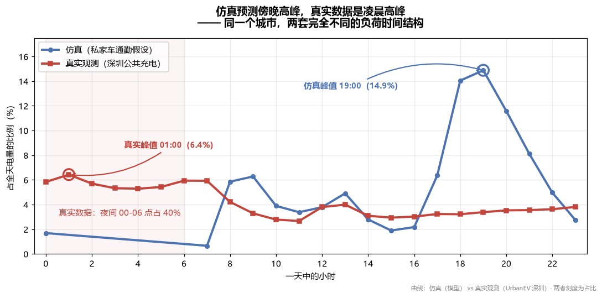
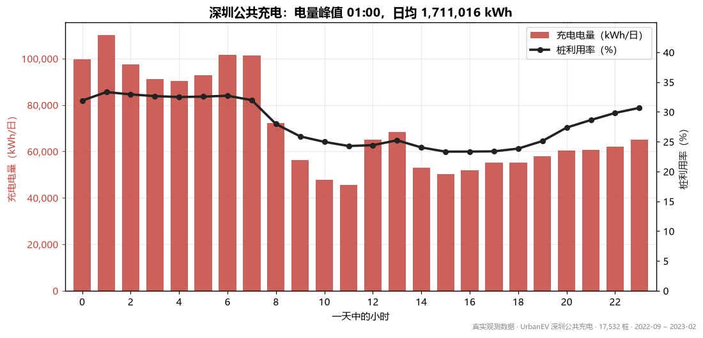
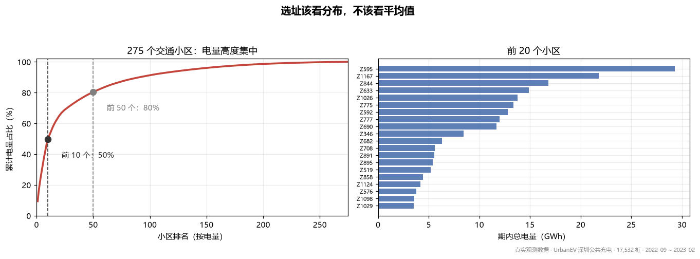
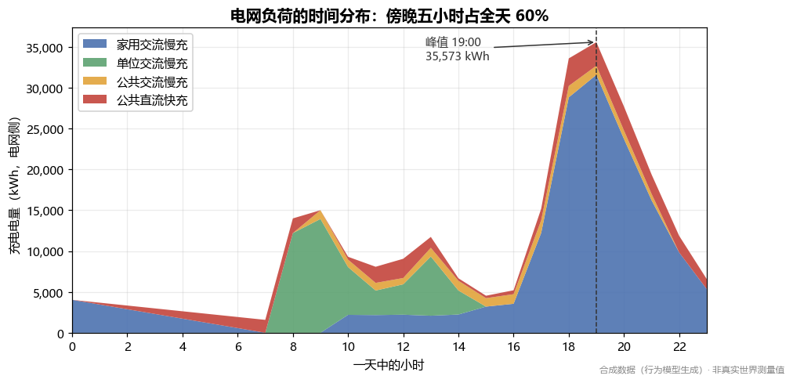
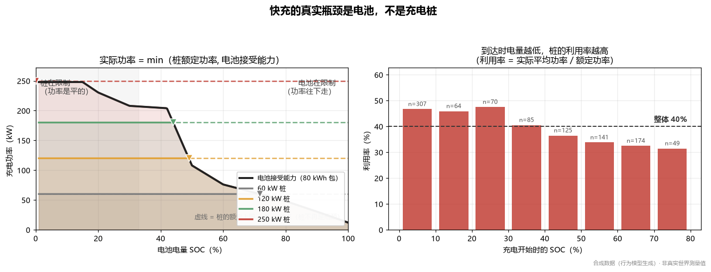
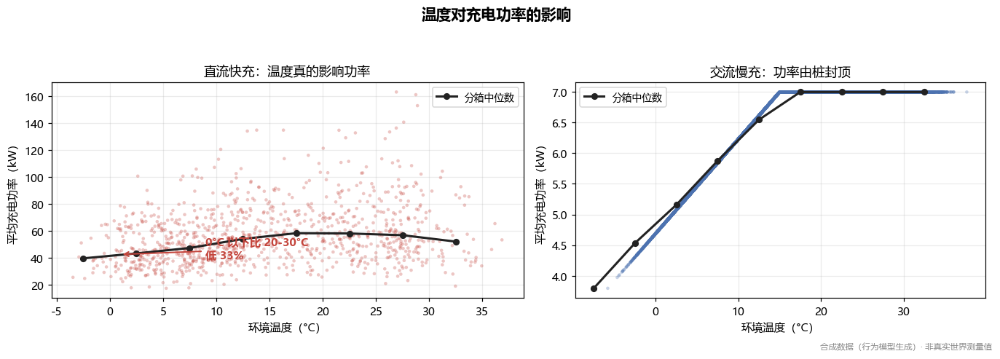
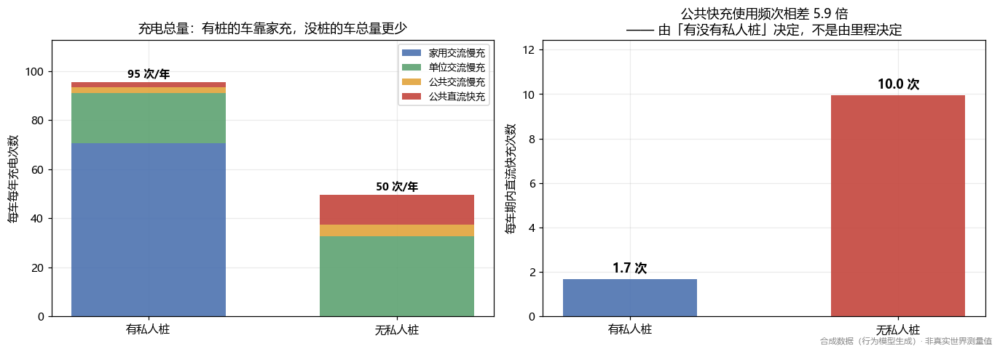
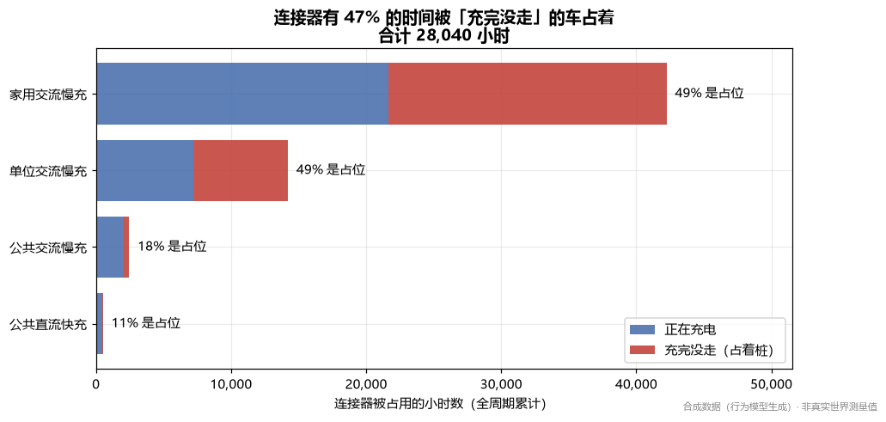

# EV 充电行为数据分析

> 两套数据，同一个问题：**城市里的电动车什么时候充电、充得多快、桩够不够用。**
>
> 一套是我写的仿真模型（可检验的假设），一套是深圳 17,532 个公共充电桩的真实观测。
> **把它们放一起看，仿真被证伪了一半 —— 而这正是本项目最有价值的部分。**

---

## 1. 三分钟看懂

本项目有两个数据源、两套分析，最后做一次正面比较。

| | 仿真数据 | 真实数据 |
|---|---|---|
| 来源 | `src/generate.py` 行为模型生成 | [UrbanEV](https://github.com/IntelligentSystemsLab/UrbanEV)（深圳公共充电，开放许可） |
| 规模 | 260 车 / 300 天 / 14,755 次充电 | 17,532 桩 / 275 交通小区 / 4,344 小时 / **311.7 GWh** |
| 粒度 | **单次充电**（含起止 SOC、功率曲线） | **小区 × 小时**（电量、占用数） |
| 能回答 | 家充影响、损耗、功率曲线 | 真实负荷结构、真实利用率、空间分布 |

```bash
# 真实数据（建议先看这个）
python scripts/fetch_data.py        # 下载 ~38 MB，一次性
python -m src.analyze_real          # 六项发现 + 与仿真的对照表
python -m src.plots --real          # 出图

# 仿真数据
python -m src.generate && python -m src.analyze && python -m src.plots
```

---

## 2. 最重要的发现：我的仿真模型错在哪



同一个问题，两个答案：

| 指标 | 仿真（私家车通勤假设） | 真实观测（深圳） | 判定 |
|---|---|---|---|
| 负荷峰值时刻 | 19:00 | **01:00** | ❌ 不一致 |
| 傍晚 17–22 点电量占比 | 60% | **21%** | ❌ 不一致 |
| 峰谷比 | 22.5 | **2.41** | ❌ 不一致 |

**真实深圳的公共充电是凌晨主导的，不是傍晚。** 夜间 00–06 点吃掉全天 **40%** 的电量，傍晚五小时只有五分之一。

### 为什么错了，以及这个错误说明了什么

我的仿真里，260 台车是**私家车**：下班回家 18 点插枪，所以傍晚峰。

真实数据指向另一个故事，有三条独立证据：

1. **周末与工作日几乎完全相同** —— 周末日均电量是工作日的 **1.022 倍**，逐小时占比最大只差 **0.5 个百分点**。私家车通勤模式下，周末理应明显不同（起床晚、通勤消失）。
2. **凌晨是绝对高峰**，而不是"夜间低谷 + 傍晚高峰"。
3. **夜间每桩功率 17.1 kW，白天 12.8 kW** —— 夜间是长时间慢充（桩被用得比较满），白天是短时补电。

这三条合起来指向：**深圳公共充电桩主要服务夜间集中充电的商业车队**（出租车 / 网约车 / 物流车），而不是私家车。

**所以这个项目不是"我的模型预测对了"，而是"我写了一个可检验的假设，然后用真实数据把它证伪了，并且证伪本身给出了一个具体的领域事实"。**

---

## 3. 真实数据的六项发现

### ① 日内负荷：凌晨主导



- 峰值 **01:00**（110,017 kWh/日），谷值 11:00（45,651 kWh/日），峰谷比 **2.41**
- 夜间 00–06 点占全天 **39.9%**；早高峰 07–09 占 13.4%；白天 10–16 占 22.3%；傍晚 17–22 占 **20.5%**

### ② 周末与工作日几乎无差别

周末日均 1,737,716 kWh vs 工作日 1,700,254 kWh，比值 **1.022**。两个峰值小时都是 01:00。

这是判断"负荷来自什么车"最有力的一条证据：通勤车辆的作息会在周末留下明显缺口，这里没有。

### ③ 空间高度集中



- 前 5 个小区占 **30.8%**，前 10 个占 **49.5%**，前 25 个占 68.7%
- 基尼系数 **0.778**

**含义**：用"全市平均每个小区"描述需求会严重误导 —— 一半能量在 10 个小区里。选址和扩容要按分布做，不是按平均值。

### ④ 网络利用率：观测值，不是模型推论

- 整体利用率 **28.0%**
- 最高时段 01:00，达 **33.3%**；逐小时范围 23.3%–33.3%
- 小区层面：中位 24.9%，**最高 82.1%**
- 完全空闲（占用数为 0）的区-小时占 2.7%

**"桩不够用"和"桩闲着"同时成立**：平均利用率不到三成，但空间和时间分布极不均匀。这是给"该不该继续建桩"这个争论的一个可用答案：不是总量不足，是**局部时段与局部地点不足**。

### ⑤ 占用桩的实际输出功率：夜间高于白天

| 时段 | kW / 每个占用桩 |
|---|---|
| 夜间 00–06 | **17.1** |
| 早高峰 07–09 | 15.3 |
| 白天 10–16 | **12.8** |
| 傍晚 17–22 | 12.7 |

夜间比白天高 **33%**。注意口径：这是 `电量 / 占用小时`，不是铭牌功率，也不是瞬时功率。

### ⑥ 半年趋势与春节效应

| 月份 | 总电量 |
|---|---|
| 2022-09 | 57.3 GWh |
| 2022-10 | 53.9 GWh |
| 2022-11 | 53.5 GWh |
| 2022-12 | 55.9 GWh |
| 2023-01 | **43.8 GWh** |
| 2023-02 | 45.2 GWh |

最高与最低相差 **23%**，1–2 月最低，与春节假期（车辆停驶、司机返乡）吻合。这类季节性如果不单独看，会被错误地平均进"常态"。

---

## 4. 仿真数据的六项发现

仿真能回答真实数据回答不了的问题（单次充电、家充条件、损耗）。以下是模型推论，**不是观测值**。

### ① 负荷高度集中在傍晚，且主要来自家用慢充



19:00 达峰值，是全天均值的 2.68 倍；17:00–22:00 五小时吃掉全天 60%；峰值时段 **89% 来自家用交流慢充**。

> 这一条已被真实数据证伪，见第 2 节。保留它是因为它清楚地显示了"假设"与"观测"的差别。

### ② 快充的真实瓶颈是电池，不是充电桩



实际功率 = `min(桩额定功率, 电池当前接受能力)`。左图阴影区是实际功率：**平的一段是桩在限制，往下走的是电池在限制**，▼ 是交点。

"高功率桩 taper 更早"是误读 —— 桩不 taper，它只是**更早不再是瓶颈**。同一台车插 60 kW 桩全程满功率，插 250 kW 桩从 16% SOC 起就受电池限制。

- 直流桩额定平均 172 kW，实际只用到 **56 kW**（利用率 **40%**）
- 低电量到达（<30% SOC）利用率 47%，高电量到达（>55% SOC）只有 33%

### ③ 低温让直流快充功率掉三分之一



0°C 以下直流平均 42.4 kW，20–30°C 为 63.2 kW，**低 33%**。交流桩夏天稳定在 7 kW（桩的额定上限），冬天低于上限 —— 夏天限制来自桩，冬天是电池变弱了。

### ④ 没有私人充电桩的车，公共快充频次高 8.9 倍



| | 有私人桩（178 台） | 无私人桩（82 台） |
|---|---|---|
| 期内充电总次数 | 69.5 次 | 29.1 次 |
| 其中直流快充 | **1.1 次** | **10.0 次** |

没桩的车总量更少（公共充电更贵更麻烦），但直流频次高 8.9 倍。

> ⚠️ 统计陷阱：不能拿两组直流总次数直接比（车辆数不同）；也不能先年化再取比 —— **比值的平均值 ≠ 平均值的比值**，我第一版图表就因此给出 6 倍而非 8.9 倍。

### ⑤ 连接器有 47% 的时间被"充完没走"的车占着



连接器被占用 59,401 小时，其中 **28,040 小时（47%）是充完没走**。家用慢充占位 120 分钟/次，单位慢充 148 分钟，公共直流只有 3 分钟。

**占位是慢充站的病，不是快充站的病。**

### ⑥ 电网到电池总损耗 9.1%

交流慢充 10%，直流快充 6%，合计 21,859 kWh。

---

## 5. 怎么复现

**环境**：Python 3.10+，依赖 `numpy` `pandas` `matplotlib`（`ipykernel` `pytest` 可选）。

```bash
pip install -i https://pypi.tuna.tsinghua.edu.cn/simple \
    "numpy>=1.24" pandas matplotlib pytest ipykernel
```

### 真实数据

```bash
python scripts/fetch_data.py          # ~38 MB，带重试与断点续传
python -m src.analyze_real            # 六项发现 + 对照表
python -m src.analyze_real --json out/real.json
python -m src.plots --real            # 三张真实数据图
```

### 仿真数据

```bash
python -m src.generate                # 约 3 秒
python -m src.analyze                 # 六项发现
python -m src.plots                   # 六张图
python -m src.main                    # 一次跑完以上三步
```

常用参数：`--days 30 --vehicles 50` 小样本快跑；`--skip-generate` 复用已有数据。

### 测试

```bash
python -m pytest tests/ -q      # 38 个测试
python scripts/run_tests.py     # 自带 runner，无 pytest 也能跑
```

> 真实数据的集成测试在 `data/real/urbanev` 缺失时会自动跳过，所以新克隆的仓库仍然全绿。

---

## 6. 模型是怎么校准的

数据是合成的，但**物理是对着实测校准的**。

### 充电曲线

用公开发表的逐 1% SOC 实测曲线（EVKX 数据库）校准：

| 对照点 | 实测 | 模型 | 误差 |
|---|---|---|---|
| Tesla Model 3 P @ 20% SOC | 230 kW | 230.4 kW | **+0.2%** |
| Tesla Model 3 P @ 50% SOC | 96 kW | 108 kW | +12.5% |
| Tesla Model 3 P @ 80% SOC | 46 kW | 48 kW | **+4.3%** |
| Tesla Model 3 P 10→80% | 33 min | 30 min | **−8%** |

**跨车型误差必须说清**：接受能力表按 Model 3 Performance 拟合，对 VW ID.4 Pro 的误差更大（80% SOC 瞬时功率 −37%，10→80% 时长 +22%）。

这不是拟合不够好，而是**单张表表达不了两台本质不同的车**：实测 ID.4 在 80% SOC 仍能接受峰值功率的 94.8%，Model 3 P 只有 57.5%。生产系统会按车型存曲线；本项目用一张共享表，并把误差**断言进测试**（`test_taper_cross_vehicle_error_is_bounded`），而不是假装没有。

### 低温能耗

用 DOE 引用的五车气候舱受控实验（AAA 执行）校准：−7 °C 开暖风实测 +39% 能耗，模型 +39%；35 °C 开空调实测 −17% 续航，模型 +17%。

### 这轮校准推翻了我最初的三条结论

| 发现 | 校准前（错） | 校准后 |
|---|---|---|
| 快充实际功率 | 额定的 86% | **40%** |
| 快充平均功率 | 121 kW | **56 kW** |
| 低温影响 | 看不出来 | **−33%** |

校准前的模型不是"跑不起来"，而是"跑得很好、数据看着也合理、结论全是错的"。这类错误不会报错，只能拿真实数字去对。

---

## 7. 测试在测什么

38 个测试，每一类都对应一个**真实发生过的 bug**。

**物理不变量（仿真）**
- 功率不超桩额定、不超电池接受能力 → *60 kW 的桩曾输出 100 kW*
- 接受曲线单调不增、复现实测功率点 → *taper 模型错两次，误差 132% 和 38%*
- 大电池的瓶颈切换点更晚 → *"高功率桩 taper 更早"的机制*
- 低温能耗符合实测 → *曾低估到 −15% 而非 +39%*

**行为不变量（仿真）**
- 车队平衡 SOC 在合理区间 → *曾漂到 70%，所有充电挤在 taper 区*
- 傍晚高峰必须涌现而非硬编码
- **季节必须跟日历一致** → *曾完全反转：1 月 28°C、7 月 4.6°C*
- 没私人桩的车更多用直流

**数据不变量（真实）**
- 时间戳必须是逐小时网格
- 占用数不能超过装机桩数
- 利用率必须在 [0,1]
- **稳健功率估计不被单行异常拖走** → *zone 775 有一行 occupancy=1 却有 5,580 kWh，逐行比值会算出 5,580 kW*
- 聚合功率落在物理范围（1–400 kW/桩）

**工程不变量**
- 固定种子完全可复现；不同种子产生不同数据
- 预热期不污染输出
- 重新生成的图表与提交版本字节一致

> **季节反转那个 bug 特别值得说**：温度数据单独看完全正常（平滑、有季节性、范围合理），所有其他测试都通过。**只有把"月份"和"温度"对起来看**才发现是反的。根因是用"运行第几天"驱动季节曲线，而运行起点是 10 月 —— 所以"第 0 天"被当成了 1 月。

---

## 8. 局限性

### 真实数据的局限

- **只有公共桩**，没有私人/小区充电。因此"家庭充电的影响"和"充电损耗"这两项只能用仿真回答。
- **只有小区×小时聚合**，没有单次会话。做不了功率曲线、起止 SOC 的分析。
- **时段为 2022-09 至 2023-02**，覆盖秋冬春，不含盛夏；夏季空调负荷未体现。
- **数据质量问题已量化**：13.3% 的区-小时因占用数 < 3 无法计算可靠的推导功率；0.04% 的行推导功率超过 400 kW 被排除；2.7% 的区-小时完全空闲。报告里逐项列出，结论必须连带这些口径一起读。

### 仿真数据的局限

- 行为假设（通勤时间、日行驶里程、目标 SOC、插枪频率）决定了结论。**傍晚高峰已被真实数据证伪**，说明这类假设很容易错。
- 充电曲线用单张 C-rate 表，跨车型误差最高 37%。
- 未建模：站点总功率上限、排队等待、电池热管理预热过程。
- 交流充电曲线假设恒功率+尾部衰减，**衰减拐点无直接出处，是推断**。

### 参数来源

每项参数标注来源等级（`standard` / `typical` / `demo-only`），完整清单与逐条 URL 见 [`docs/charging_behavior_sources.md`](docs/charging_behavior_sources.md)。

**最大缺口**：单次充电时长、单次电量、起止 SOC 的**真实分布**没有找到可引用来源（INL EV Project 报告是 PDF，ACN-Data 需注册 token）。这几项目前来自行为假设。

### 方法论上的两个教训

1. **比值的平均值 ≠ 平均值的比值。** 同一个发现，两种算法给出 8.9 倍和 6.0 倍。聚合功率时同理：用 `总电量/总占用小时`，不要用逐行比值的均值 —— 后者会被单行异常主导。
2. **参数错不报错，只是安静地让结论变错。** 五个修掉的缺陷全部属于这一类，全部靠"拿真实数字去对"或"把月份和温度对起来看"才发现。

---

## 9. 代码结构

```
charging-insights/
├── src/
│   ├── generate.py      仿真：电池物理 + 用户行为（~1000 行）
│   ├── analyze.py       仿真六项分析
│   ├── plots.py         图表（含 CJK 字体处理、真实/仿真两套）
│   ├── real_data.py     UrbanEV 加载器：宽表 -> 小区×小时，含质量校验
│   ├── analyze_real.py  真实数据六项分析 + 与仿真的对照表
│   └── main.py          仿真一键入口
├── scripts/
│   ├── fetch_data.py    数据集下载（重试 + 断点续传 + manifest）
│   └── run_tests.py     自带测试 runner（无 pytest 也能跑）
├── tests/
│   ├── test_generate.py    仿真
│   └── test_real_data.py   真实数据（无数据时跳过）
├── figures/             9 张图（已提交，README 直接引用）
├── docs/
│   └── charging_behavior_sources.md   参数来源汇编（408 行，全部带 URL）
├── .vscode/settings.json
└── data/                下载/生成的数据（已 gitignore）
```

### 几个值得说的设计决策

**为什么先做仿真，再接真实数据**
仿真能探索真实数据没有的自由度（单次会话、家充条件、损耗），但它只是假设。先写假设、再用真实数据检验，比单独做任何一个都更有说服力 —— 而且这次检验真的把假设推翻了一半。

**为什么把物理参数集中在一个文件里**
`generate.py` 顶部所有常量都带来源标注（`[Behav]` 行为假设 / `[Phys]` 物理关系 / `[TODO]` 待考证），审阅者可以一次看完整个模型的假设。

**为什么用查表插值而不是拟合曲线**
BMS 实际就是这么实现的；查表不会像拟合曲线那样过冲；实测点可以直接填进去。

**为什么每张图都印着数据来源**
图比文字传播得远。一张看起来像真实测量的图如果不说清楚，就是误导。仿真图和真实图的声明文字不同，不会混淆。

**中文 Windows 的两个坑**
- 控制台是 GBK 编码，输出 `⚠` 这类字符会直接崩溃 → `analyze.py` 里强制 stdout 用 UTF-8
- matplotlib 默认没有中文字体，标签渲染成方块 → `plots.py` 里探测可用字体，并关掉 `axes.unicode_minus`（否则负号也是方块）

---

## 10. 数据字典

### 真实数据（`load_zone_hourly()` 输出）

| 列 | 含义 |
|---|---|
| `zone_id` | 交通小区（TAZ）编号，共 275 个 |
| `timestamp` / `hour` / `weekday` / `is_weekend` | 时间维度 |
| `volume_kwh` | 该小区该小时充入的电量 |
| `occupancy` | 该小时处于占用状态的桩数 |
| `n_piles` | 该小区装机桩数（由 `inf.csv` 汇总） |
| `mean_power_kw` | `volume/occupancy`，占用数 <3 时置空 |
| `utilisation` | `occupancy/n_piles` |
| `duration_h` | 平均充电时长 |
| `power_implausible` | 推导功率超 400 kW 的标记，聚合时排除 |

### 仿真数据（`sessions.csv`）

| 字段 | 含义 |
|---|---|
| `station_type` | `HOME_AC` / `WORK_AC` / `PUBLIC_AC` / `PUBLIC_DC` |
| `duration_min` / `idle_min` | 充电时长 / 充完占位时长 |
| `energy_kwh` / `energy_grid_kwh` | 电池侧 / 电网侧电量 |
| `avg_power_kw` / `peak_power_kw` | 时间加权平均功率 / 峰值 |
| `start_soc` / `end_soc` | 起止电量 |
| `power_curve` | 功率曲线采样（逗号分隔） |

---

## 11. 数据来源与许可

**本项目代码**：MIT，见 [LICENSE](LICENSE)。

**UrbanEV 数据集**：[IntelligentSystemsLab/UrbanEV](https://github.com/IntelligentSystemsLab/UrbanEV)，
论文 *UrbanEV: An Open Benchmark Dataset for Urban Electric Vehicle Charging Demand
Prediction*（Scientific Data, 2025）。使用请遵循上游许可。

**参数来源汇编**：[docs/charging_behavior_sources.md](docs/charging_behavior_sources.md)，
其中引用的第三方资料版权归原作者所有。
